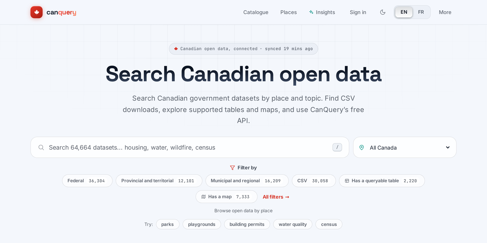
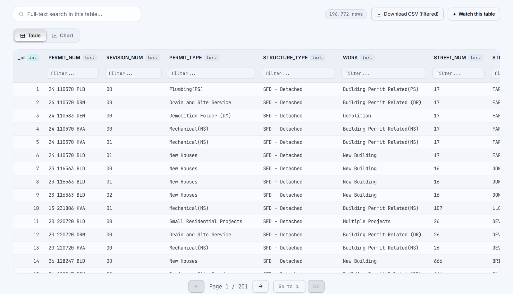
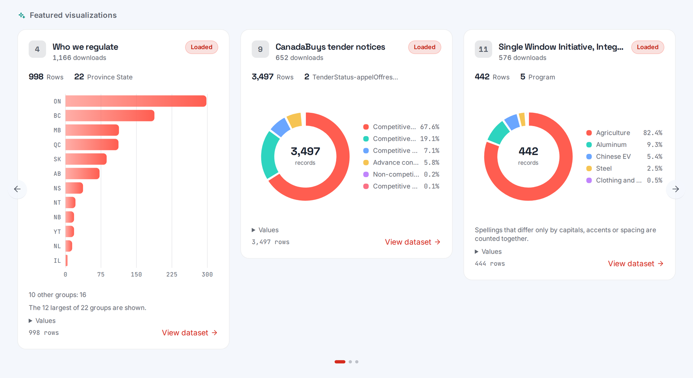
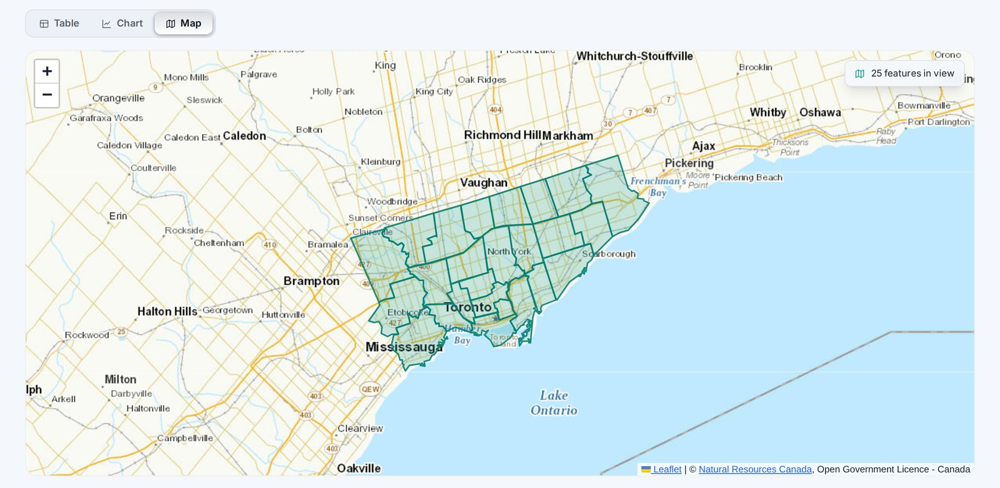
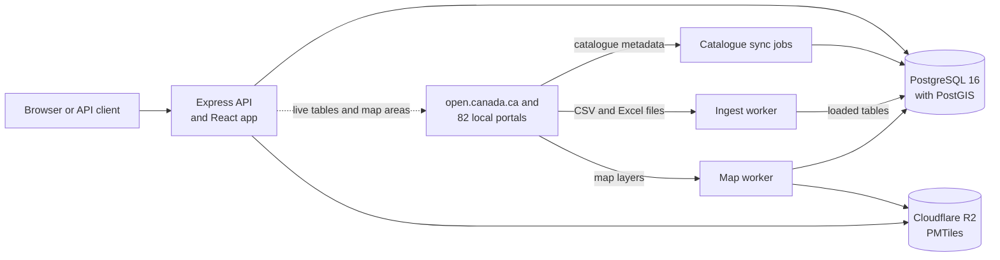

# CanQuery

**Search, preview, chart and map Canada's open data in one place.**

CanQuery brings the federal catalogue at [open.canada.ca](https://open.canada.ca) and 82 municipal,
regional and territorial open data portals together in one bilingual (English/French) website and
API. You can find a dataset, look inside its files and query them as tables or maps without
downloading anything first.

[canquery.com](https://canquery.com) · [API docs](https://canquery.com/docs) ·
[Data guides](https://canquery.com/blog) · [Portal directory](https://canquery.com/portals)

[](https://github.com/RyuPrad/canquery/actions/workflows/ci.yml)
[](LICENSE)



## Why

Canadian open data is spread across one federal catalogue and dozens of city and regional portals
that run different software (CKAN, ArcGIS Hub, Socrata, Opendatasoft). Most data is published as
CSV or Excel downloads, and only some of it is loaded into an API you can query. Finding out what
a file contains usually means downloading it and opening it in a spreadsheet.

CanQuery mirrors the catalogue metadata from all of these portals, keeps each publisher's source
page and licence attached, and turns supported files into tables you can search, filter, chart
and export in the browser or through the API.

## What it does

- **One catalogue.** More than 64,000 datasets and 260,000 files from 83 portals, with
  English and French full-text search and filters for level of government, publisher, portal,
  format, keywords and whether a dataset has a queryable table or a map.
- **Places.** Datasets are linked to places in the Statistics Canada geography (2021 SGC), so each
  city, region, province and territory has a page with the data published for it.
- **Tables from files.** A CSV or Excel file is loaded into PostgreSQL on demand when someone opens
  it. A CSV that is not loaded yet shows its first rows straight away, and small tables are held
  whole in the browser, so sorting, filtering and paging answer without another request.
- **Charts with checks.** A rules-based engine reads a sample of each table, works out what each
  column holds (a measure, a date, a category, a code, a total row) and keeps only the charts that
  pass its checks. The numbers come from the whole table, each chart says what was left out, and a
  table with no sensible chart says so.
- **Maps.** ArcGIS layers are queried live for the visible area, GeoJSON is indexed in PostGIS,
  and Socrata layers are built into vector tiles (PMTiles) and drawn with MapLibre.
- **A free read API.** `/api/v1` serves datasets, files, rows, aggregates and map features in one
  JSON response shape, described by an [OpenAPI 3.1 document](https://canquery.com/api/v1/openapi.json).
- **Guides and topic pages.** 25 data guides in English and French (such as Toronto building
  permits or ward maps), an employer search across every published list of positive LMIA employers,
  the OAS and GIS benefit amounts by income, and a [directory](https://canquery.com/portals) of
  every portal CanQuery reads.

| A live table from the City of Toronto | Charts from the chart engine | Toronto's 25 wards on the map |
|---|---|---|
|  |  |  |

## How files become tables

| What the portal provides | What CanQuery does |
|---|---|
| A live API table (CKAN DataStore) | Queries the portal's own API, with a five-minute cache |
| A CSV, XLSX or XLS file within the size, row and column limits | Loads it on demand into a PostgreSQL snapshot and queries that |
| Anything else | Shows the metadata, the licence and a link to the original file |

Loaded copies are shared by every visitor, expire after a day without use unless pinned, and
stay within a fixed storage budget. A refreshed file is loaded into a new table that replaces the
old one in a single step, so a reader never sees a half-loaded table.

## Architecture



- **API** (`server/`): Express 5 on Node.js 22. Routes stay thin, logic lives in services and SQL
  in `server/db/`. The same process serves the built React app with server-rendered page content,
  so catalogue pages work without JavaScript.
- **Catalogue sync**: scheduled jobs harvest open.canada.ca (a full harvest plus an incremental sync
  every 30 minutes) and each local portal through its adapter: CKAN, ArcGIS Hub, Socrata,
  Opendatasoft or a custom JSON feed. The source registry is in `server/config/catalogSources.js`.
- **Ingest worker**: one worker owns the preparation queue through a PostgreSQL advisory lock,
  claims jobs with `SKIP LOCKED`, renews its lease with heartbeats and recovers crashed jobs.
  Files are streamed into PostgreSQL with `COPY`.
- **Map worker**: indexes GeoJSON into PostGIS and builds PMTiles archives with a pinned Tippecanoe,
  stored privately in Cloudflare R2 and served as vector tiles through the API.
- **Client** (`client/`): React 19 with Vite, React Router, Tailwind CSS and daisyUI, Recharts,
  Leaflet and MapLibre GL. The interface is in English and French.

## Engineering notes

- **Untrusted downloads.** Catalogue links are treated as untrusted: only public HTTP(S) addresses
  are allowed, DNS is checked and pinned on every redirect, private networks are refused, and
  size and stall limits apply. Excel files are checked for zip bombs and converted in a child
  process with memory and time limits and no secrets in its environment.
- **Typed columns.** CSV columns are typed from a sample, then every value is validated with
  PostgreSQL's `pg_input_is_valid` before a column is converted. A column with a value that does not
  fit stays text, and codes with leading zeros are kept as written.
- **Consistent reads.** API clients can pin a snapshot token so that every page of a result comes
  from the same copy of a table. Old tables are dropped only when no reader holds them.
- **Bounded work.** Rate limits, a queue ceiling, statement timeouts and a storage budget keep load
  predictable. When a client disconnects, its upstream requests and PostgreSQL queries are cancelled.
- **Safe SQL.** Values are always parameterized, and the columns named in a filter or sort are
  checked against the table's recorded schema.
- **Least privilege.** The API, the ingest worker and the map worker connect with separate database
  roles ([`deploy/database/runtime-roles.sql`](deploy/database/runtime-roles.sql)), and an
  integration test checks what each role can and cannot read or write.
- **Reproducible releases.** CI packages the exact tested commit and frontend build with a SHA-256
  manifest of every file, and a release is installed read-only and switched in one step
  ([`deploy/release.py`](deploy/release.py)). Backups are encrypted and checked after upload, and an
  observer reports the health of each component.

## Repository layout

```
server/              Express API, catalogue sync, workers and tests
  config/            source registry and limits
  routes/ controllers/ services/ db/
  services/charts/   the chart engine
  scripts/           sync jobs, ingest and map workers, migration runner
  sql/migrations/    forward-only SQL migrations
  __tests__/         Jest unit and API tests
  integration/       suites that run against a real PostGIS database
client/              React app: pages, components, hooks, utils, English and French strings
content/blog/        the data guides (paired English and French Markdown, JSON manifest)
deploy/              systemd units and release, backup, monitoring and mail tooling
scripts/             source and release verification, release packaging
```

## Run it locally

You need Node.js 22 and PostgreSQL 16 with PostGIS 3.5.

```bash
# Database
createdb canquery_dev
psql canquery_dev -c 'CREATE EXTENSION IF NOT EXISTS postgis;'
psql canquery_dev -c 'CREATE EXTENSION IF NOT EXISTS unaccent;'

# Install and configure
npm ci --prefix server
npm ci --prefix client
cp server/.env.example server/.env        # set CANQUERY_DATABASE_URL

# Schema and the Statistics Canada place hierarchy
npm --prefix server run migrate
npm --prefix server run sync:places

# A small part of the catalogue: 100 federal datasets and one city portal
(cd server && node scripts/catalog-sync.js --limit=100)
npm --prefix server run sync:source -- --source=toronto-open-data --limit=10

# Run each in its own terminal
npm --prefix server run dev               # API on http://localhost:3100
npm --prefix client run dev               # app on http://localhost:5173
node server/scripts/ingest-worker.js      # optional: loads files into tables
```

Any source can be checked first with `--dry-run`. Maps from Socrata portals also need Tippecanoe
and an R2 bucket; everything else runs without them.

## Tests

```bash
npm --prefix server run verify               # lint, unit and component tests, guide checks, production build
npm --prefix server run verify:integration   # database suites, on a disposable PostgreSQL/PostGIS database
```

The server uses Jest and Supertest, the client Vitest and Testing Library, and the database suites
run against a real PostgreSQL 16/PostGIS 3.5 database. [CONTRIBUTING.md](CONTRIBUTING.md) explains
the integration setup. CI runs six jobs on every pull request: server, client, database, the core on
its own, a check that no hosted-service code is in this repository, and the release artifact.

## API

The read API is open: no key is needed, within per-address rate limits. JSON responses have the
shape `{ data, pagination: { nextCursor }, meta }`.

```bash
# Search the catalogue
curl 'https://canquery.com/api/v1/datasets?q=building%20permits&place=toronto-on&limit=5'

# A dataset and its files; each file says whether it is a live table, loaded, loadable or download-only
curl 'https://canquery.com/api/v1/datasets/toronto-open-data-building-permits-active-permits'

# Rows from a file, filtered
curl --get 'https://canquery.com/api/v1/resources/ckan-toronto-open-data-resource-6d0229af-bc54-46de-9c2b-26759b01dd05/query' \
  --data-urlencode 'filters={"STREET_NAME":"KING"}' --data-urlencode 'limit=5'

# Map features inside a bounding box (Toronto's wards)
curl 'https://canquery.com/api/v1/resources/ckan-toronto-open-data-resource-7672dac5-b383-4d7c-90ec-291dc69d37bf/map?bbox=-79.64,43.58,-79.11,43.86&zoom=10'
```

Filters accept `eq`, `lt`, `gt`, `lte`, `gte` and `contains` on loaded tables; a portal's live
table accepts equality only. Aggregates, CSV export, file preparation and vector tiles are covered
in the [API docs](https://canquery.com/docs).

## Editions

This repository is the open-source core of CanQuery: the catalogue website, the anonymous
`/api/v1` and `/web-api/v1` APIs, table preparation, maps and the operations tooling. It runs on
its own, and CI checks that it builds, passes its tests and starts against a fresh database without
anything else installed.

canquery.com also runs a hosted layer on top of this core, with accounts, dataset alerts, API keys
and paid plans. That layer is not part of this repository. It plugs in through the extension hooks
in `server/extensions/index.js` and `client/src/extensions.js`; without it, every hook does nothing.

## Data and licences

The code is under the [MIT licence](LICENSE). The data belongs to its publishers and stays under
each publisher's licence, such as the Open Government Licence – Canada; CanQuery shows the source
and licence on every dataset and file, and only admits records that carry a recognized open
licence. Problems with a dataset itself belong with its publisher.

CanQuery is an independent project, built by [@RyuPrad](https://github.com/RyuPrad). It is not an
official Government of Canada service and is not affiliated with the Government of Canada.

## Contributing and security

See [CONTRIBUTING.md](CONTRIBUTING.md) for setup, conventions and tests, and
[SECURITY.md](SECURITY.md) to report a vulnerability privately.
